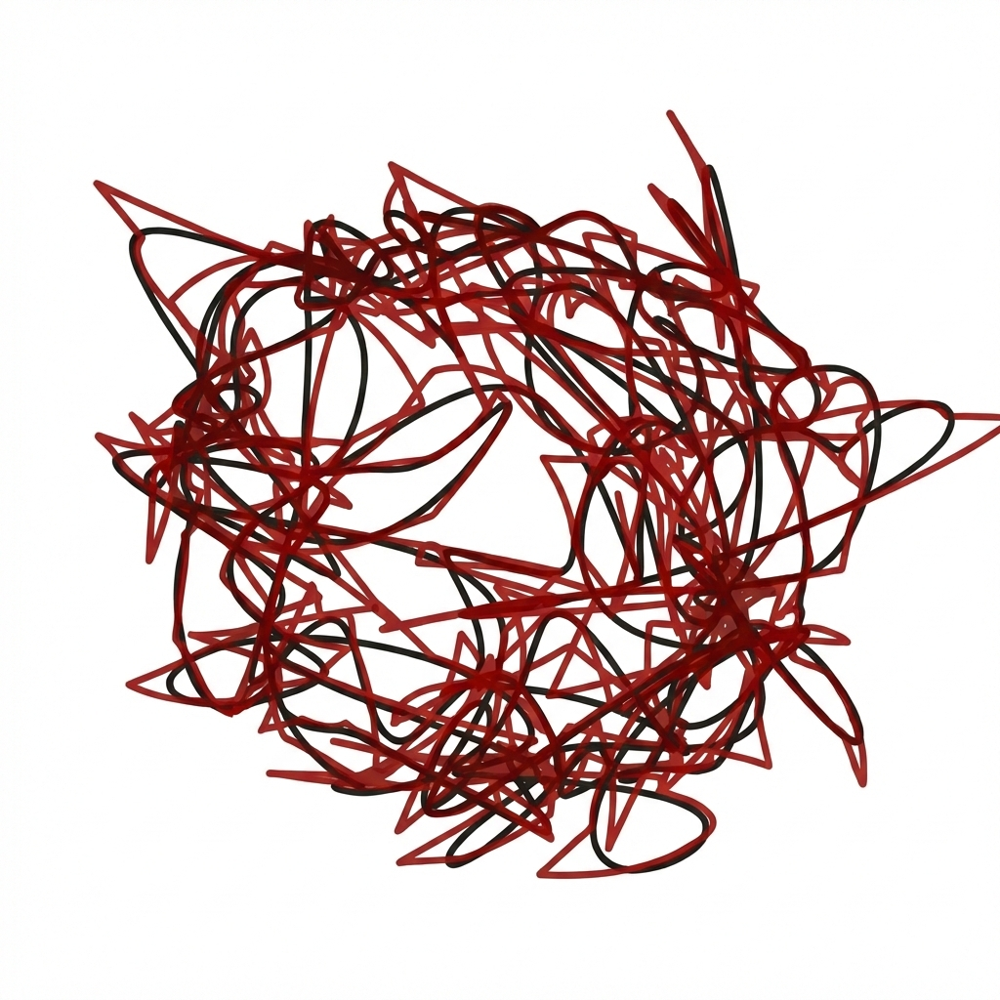
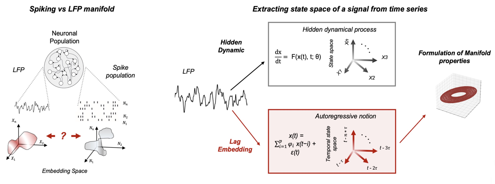
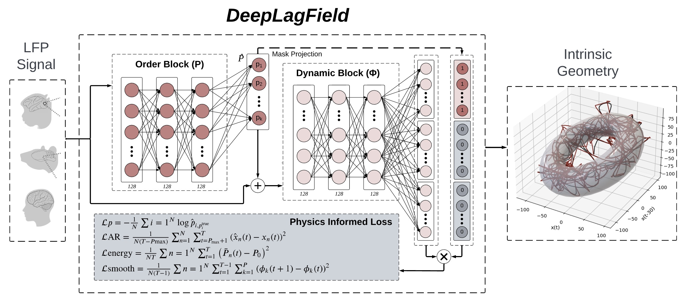
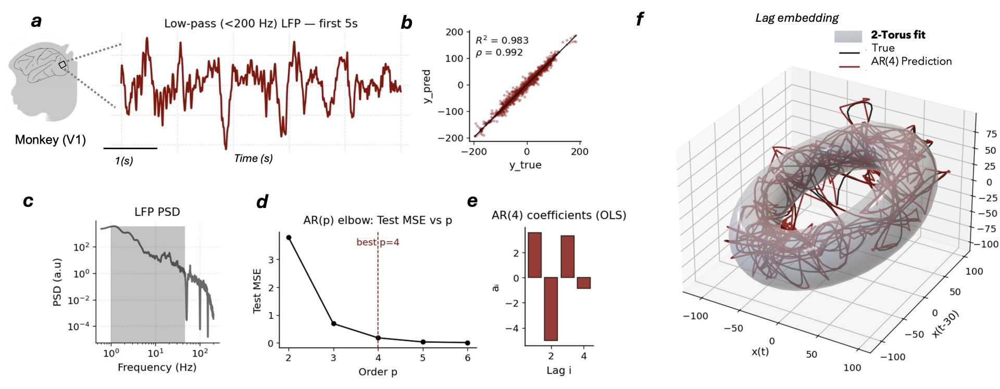
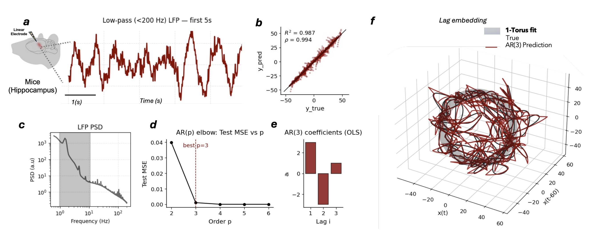
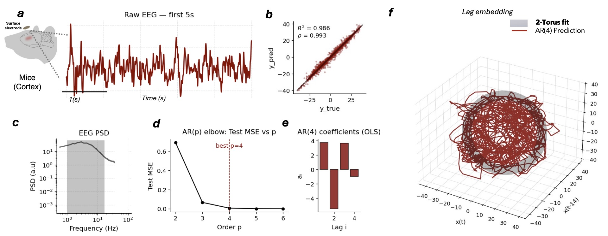

<p align="center">
  
</p>

<h1 align="center">Neural Field Manifold</h1>
<p align="center"><em>Autoregressive dynamics and delay-coordinate geometry for neural time series</em></p>

<p align="center">
  <a href="https://www.python.org/downloads/"></a>
  <a href="https://pytorch.org/"></a>
  <a href="LICENSE"></a>
  <a href="https://erfanzabeh.github.io/NeuralFieldManifold/"></a>
</p>

## Overview

**Neural Field Manifold** connects local signal dynamics to the geometry of
delay embeddings. Use it to process neural recordings, fit autoregressive
models, reconstruct delay-coordinate trajectories, and quantify ring and
torus geometry.

The package includes **DeepLagField**, a PyTorch model that jointly estimates
autoregressive order and time-varying coefficients. NumPy and SciPy tools
support classical AR models, synthetic dynamical systems, and geometric fits.

<p align="center">
  
</p>

## Installation

Requires Python 3.10 or later. Install from GitHub:

```sh
python -m pip install "neuralfieldmanifold @ git+https://github.com/erfanzabeh/NeuralFieldManifold.git@main"
```

For plotting and the tutorial notebooks:

```sh
python -m pip install "neuralfieldmanifold[tutorials] @ git+https://github.com/erfanzabeh/NeuralFieldManifold.git@main"
```

## Quick Start

Load a recording, process the signal, and fit a torus to its delay embedding:

```python
import neuralfieldmanifold as nfm

recording = nfm.datasets.load("monkey_lfp")
processed = nfm.preprocessing.process(
    recording.signal,
    sampling_rate_hz=recording.sampling_rate_hz,
    config=nfm.preprocessing.PreprocessConfig(
        notch_hz=50,
        band_hz=(1, 50),
        envelope_band_hz=(1, 80),
        envelope_lowpass_hz=3,
    ),
)
cloud = nfm.embedding.delay(processed.signal, dimension=3, tau_samples=30)
fit = nfm.geometry.fit_torus(cloud)
print(f"Torus score: {fit.score:.3f}; error: {fit.error:.3f}")
```

Bundled samples include 20 seconds of monkey LFP at 500 Hz and five seconds
of mouse LFP at 20 kHz. To use your own recording, supply a one-dimensional
NumPy array and its sampling rate. Processing bands and delays should be
chosen for that recording.

## DeepLagField

DeepLagField couples an order-selection network to a dynamics network. The
selected order determines which lag coefficients are active; the dynamics
network estimates those coefficients over time. Training combines signal
reconstruction, supervised order selection, target-power regularization, and
temporal smoothness.

<p align="center">
  
</p>

The [DeepLagField tutorial](https://erfanzabeh.github.io/NeuralFieldManifold/tutorials/deeplagfield.html)
covers dataset generation, training, evaluation, and checkpoints.

## Tutorials

| Tutorial | Topics |
|---|---|
| [Monkey LFP](https://erfanzabeh.github.io/NeuralFieldManifold/tutorials/monkey.html) | Filtering, AR prediction, and delay geometry |
| [Mouse LFP: 1-50 Hz](https://erfanzabeh.github.io/NeuralFieldManifold/tutorials/mouse.html) | Envelope normalization and delay geometry |
| [Mouse LFP: 1-20 Hz](https://erfanzabeh.github.io/NeuralFieldManifold/tutorials/mouse_lfp.html) | Low-frequency dynamics and delay embedding |
| [Lorenz dynamics](https://erfanzabeh.github.io/NeuralFieldManifold/tutorials/lorenz.html) | Simulation and threshold autoregression |
| [Oscillatory modes](https://erfanzabeh.github.io/NeuralFieldManifold/tutorials/intrinsic_dimension.html) | AR pole pairs and embedding dimension |
| [DeepLagField](https://erfanzabeh.github.io/NeuralFieldManifold/tutorials/deeplagfield.html) | Learned order and time-varying coefficients |
| [Source mixing](https://erfanzabeh.github.io/NeuralFieldManifold/tutorials/source_mixing.html) | Sensor mixtures and geometric comparison |

## Gallery

<p align="center">
  
  <br><sub>Monkey LFP reconstruction</sub>
</p>
<p align="center">
  
  <br><sub>Mouse neural recording reconstruction</sub>
</p>
<p align="center">
  
  <br><sub>Low-frequency reconstruction</sub>
</p>

## Documentation and Support

See the [user guide](https://erfanzabeh.github.io/NeuralFieldManifold/getting_started.html)
and [API reference](https://erfanzabeh.github.io/NeuralFieldManifold/api.html).
Report bugs or request features in [GitHub Issues](https://github.com/erfanzabeh/NeuralFieldManifold/issues).
Development instructions are in [CONTRIBUTING.md](CONTRIBUTING.md).

Released under the [MIT license](LICENSE).
